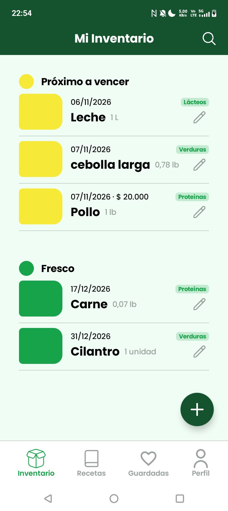
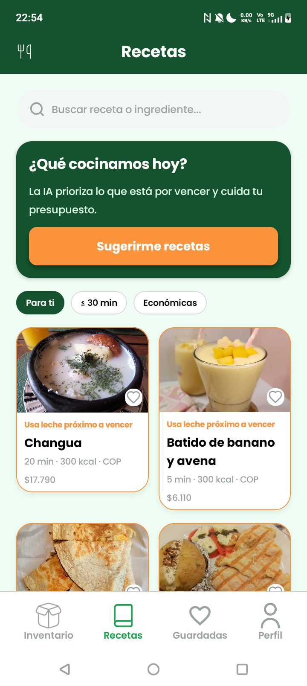
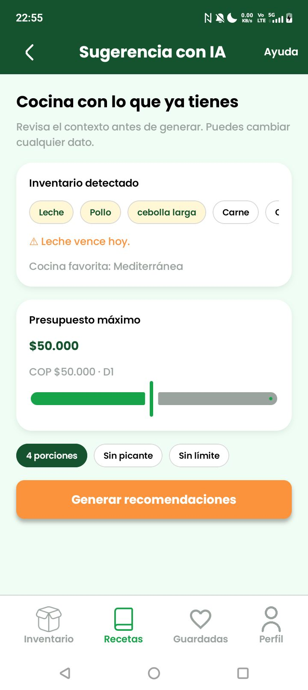
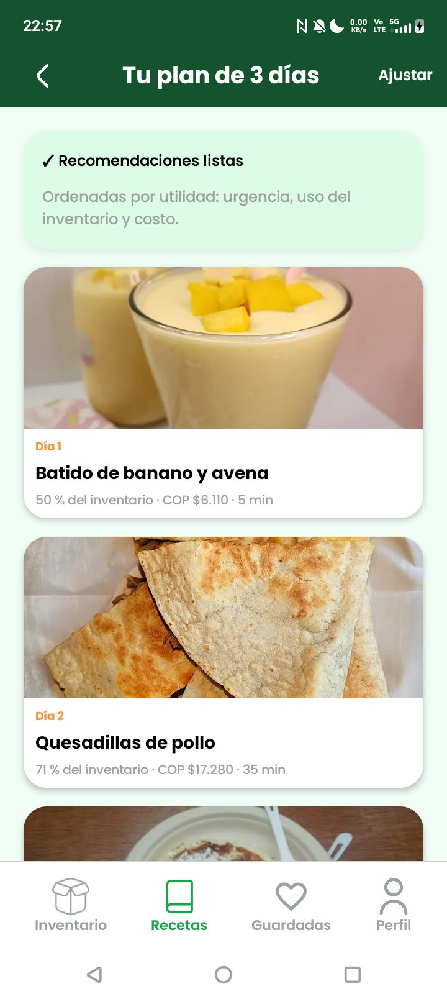
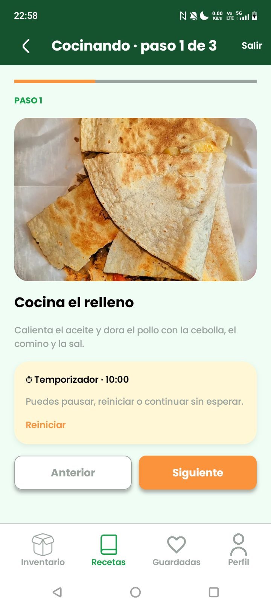
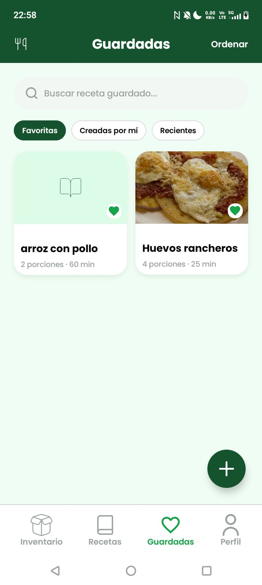
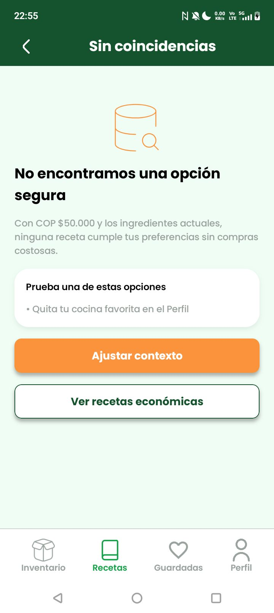
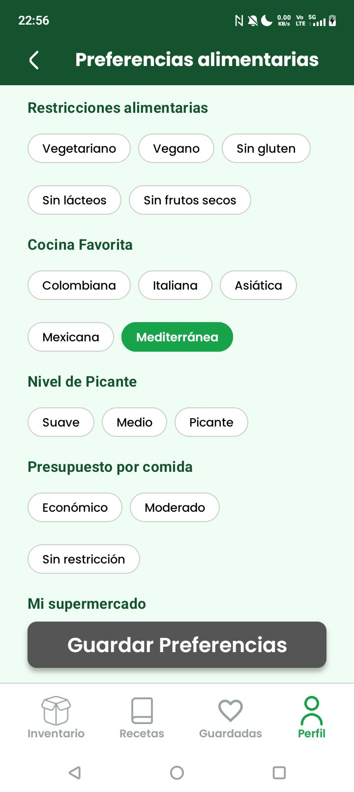
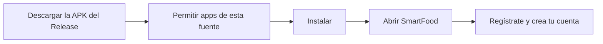

# SmartFood

App Android para **reducir el desperdicio de comida en casa**. Une el inventario de la despensa, las fechas de
vencimiento y el presupuesto, y sobre ellos actúa un **agente de IA** que arma un plan de comidas de 3 días para
aprovechar primero lo que está por vencer.

- **Inventario:** productos con fecha de vencimiento, foto, búsqueda por texto o voz y aviso diario. Funciona sin conexión.
- **Recetas:** catálogo propio de **70 recetas** de cocina colombiana, italiana, asiática, mexicana y mediterránea, con
  cocina guiada paso a paso y temporizador.
- **Sugerencia con IA:** un plan de 3 días que usa tu inventario, respeta tu presupuesto, tus restricciones alimentarias
  y tu **Cocina Favorita**, y explica por qué te conviene.
- **Guardadas:** recetas favoritas y recetas propias que puedes crear, editar y eliminar.
- **Cuenta y perfil:** registro con correo, recuperación de contraseña con código y preferencias alimentarias.

Proyecto de **Construcción de Aplicaciones Móviles** e **Inteligencia Artificial** — UTADEO 2026-2.

## Integrantes

- Dariany Natalia Bernal Duarte
- Laura Nikoll Malagón Gómez
- Santiago Ardila Vargas
- Zhair David Gómez Miranda

## Versión funcional

La última versión funcional está en la rama **`master`** de este repositorio. La APK lista para instalar está en el
Release [`v1.0-entrega`](https://github.com/ZhairG/Smartfood/releases/tag/v1.0-entrega).

## Capturas

| Inventario | Recetas | Sugerencia con IA | Plan de 3 días |
|---|---|---|---|
|  |  |  |  |

| Cocina guiada | Guardadas | Sin plan posible | Preferencias alimentarias |
|---|---|---|---|
|  |  |  |  |

## Instalar la app

La forma más rápida es instalar la APK en un teléfono Android (7.0 o superior, con internet). Se hace en 2 minutos:



1. Desde el teléfono, abre el Release [`v1.0-entrega`](https://github.com/ZhairG/Smartfood/releases/tag/v1.0-entrega) y
   descarga **`SmartFood-release.apk`**.
2. Ábrela. Android avisará que no permite instalar apps de esa fuente: toca **Configuración** y activa **Permitir desde
   esta fuente**.
3. Vuelve atrás y toca **Instalar**. Si Google Play Protect pregunta, elige **Instalar de todos modos** (la APK no viene
   de la tienda).
4. Abre **SmartFood**, toca **Regístrate** y crea una cuenta con tu correo.

Detalle, permisos y solución de problemas: [guía de instalación](docs/instalacion.md#a-instalar-la-apk).

## Compilar desde el código

Compilar exige **dos cosas privadas del equipo**, porque la app usa un backend real en Firebase:

| Restricción | Qué pasa si falta |
|---|---|
| El archivo `app/google-services.json` no está en el repositorio (tiene la clave de API del proyecto) | El proyecto **no compila** |
| La clave de API solo acepta la app `com.smartfood.app` con la huella **SHA-1** registrada; **cada computador tiene la suya** | Compila y abre, pero el **registro y el inicio de sesión fallan** |

Sin esas dos cosas se puede **leer todo el código y las especificaciones**; para ejecutar la app hay que pedírselas al
equipo, o instalar la APK del Release, que ya viene firmada con la huella registrada. La guía paso a paso (clonar,
Gradle Sync, `google-services.json`, SHA-1, compilar y ejecutar), los modos **demo** y **emuladores**, y los errores más
comunes están en la **[guía de instalación](docs/instalacion.md#b-compilar-desde-el-código)**.

Resumen de lo necesario: Android Studio 2026.2 o más reciente, Android SDK 37, Git, e internet para la primera
sincronización. No hay que instalar Gradle ni Java por separado: el *Gradle Wrapper* descarga el JDK 25 que necesita.

## Pruebas

```bash
./gradlew :app:testDebugUnitTest          # 483 pruebas unitarias (en Windows: gradlew.bat)
./gradlew :app:lintDebug                  # Android Lint
./gradlew :app:connectedDebugAndroidTest  # Pruebas instrumentadas (necesitan teléfono o emulador)
npm --prefix functions test               # Cloud Functions
```

## Datos del proyecto

| | |
|---|---|
| Paquete | `com.smartfood.app` |
| minSdk / compileSdk / targetSdk | 24 / 37 / 37 |
| Android Gradle Plugin | 9.4.1 |
| Gradle | 9.6.0 (Wrapper) |
| Kotlin | 2.2.10 |
| Compatibilidad del código | Java 11 |
| Firebase | `smartfood-f62a1`, región `southamerica-east1` |

## Stack

- **UI:** Jetpack Compose + Material 3, tipografía Poppins, diseño fiel al [Figma](https://www.figma.com/design/z1AoQvluQcmx98gjP4vHF6/SmartFood).
- **Arquitectura:** Clean Architecture por funcionalidad (`ui → domain ← data`), MVVM con flujo unidireccional, Hilt y
  Navigation Compose con rutas tipadas, en un solo módulo `:app`.
- **Agente de IA:** problema de optimización con restricciones (CSP/COP) resuelto con *backtracking*, *forward checking*
  y poda por cota optimista. Comparado con A\*, recocido simulado y un algoritmo voraz.
- **Backend:** Firebase Authentication, Cloud Firestore, Cloud Storage y Cloud Functions (TypeScript).
- **Segundo plano:** WorkManager (subida de fotos y aviso diario de vencimientos).

## Estructura (`app/src/main/java/com/smartfood/app/`)

| Paquete | Contenido |
|---|---|
| `core/` | Sistema de diseño (tema, tokens y componentes `SmartFood*`), navegación, inyección de dependencias y utilidades |
| `feature/auth` | Registro, inicio de sesión y recuperación de contraseña |
| `feature/inventory` | Inventario: lista, búsqueda por voz, editor con foto y aviso diario |
| `feature/recipes` | Catálogo, agente de IA, cocina guiada, recetas guardadas y propias |
| `feature/profile` | Perfil y preferencias alimentarias |
| `feature/legal`, `feature/splash` | Términos y política de privacidad; pantalla de arranque |

Cada funcionalidad se divide en `domain` (Kotlin puro), `data` (Firebase) y `ui` (pantallas y ViewModels). Fuera de `app/`
están `functions/` (backend en TypeScript), `specs/` (especificaciones), `docs/` y `rules-test/` (pruebas de las reglas
de seguridad).

## Documentación

- **[Wiki del proyecto](https://github.com/ZhairG/Smartfood/wiki):** instalación, arquitectura, backend, agente de IA y flujo de trabajo.
- [Guía de instalación](docs/instalacion.md): APK, compilación, restricciones y problemas comunes.
- [Arquitectura](docs/arquitectura.md): capas, flujo completo de una pantalla y mapa de carpetas.
- [Backend](docs/backend.md): Cloud Functions, despliegue, emuladores y modo demo.
- [Evaluación del agente de IA](docs/ia/evaluacion-agente.md) y [guía de sustentación](docs/ia/sustentacion-agente.md).
- [Especificaciones](specs/constitution.md) (SDD) y su [estado](docs/metodologia.md).
- [Configuración del equipo](docs/equipo.md): pasos de cada integrante para ejecutar la app contra el Firebase del proyecto.
- [Diseño en Figma](https://www.figma.com/design/z1AoQvluQcmx98gjP4vHF6/SmartFood).
