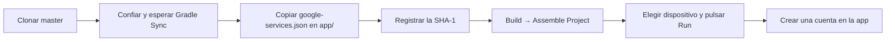

# Guía de instalación de SmartFood

Hay dos maneras de usar SmartFood. Elige según lo que quieras hacer:

| Quiero… | Camino | Tiempo | Qué necesito |
|---|---|---|---|
| **Probar la app** en un teléfono | [A. Instalar la APK](#a-instalar-la-apk) | 2 minutos | Un teléfono Android 7.0 o superior con internet |
| **Ver y compilar el código** | [B. Compilar desde el código](#b-compilar-desde-el-código) | 30 minutos o más | Android Studio y un archivo privado del equipo (`google-services.json`) |

Si eres integrante del equipo y vas a ejecutar la app contra el Firebase del proyecto, lee además
[`equipo.md`](equipo.md).

---

## A. Instalar la APK

La APK está publicada en la página de **Releases** del repositorio: [`v1.0-entrega`](https://github.com/ZhairG/Smartfood/releases/tag/v1.0-entrega).
Es la versión de la rama `master` compilada en modo *release* (con R8, optimizada).

### Requisitos

| | |
|---|---|
| Sistema | Android 7.0 (API 24) o superior |
| Internet | Sí. Para registrarse, iniciar sesión y guardar se necesita conexión. El inventario sigue funcionando sin conexión y sincroniza al volver |
| Espacio | Unos 10 MB para la APK |

### Pasos

1. Desde el teléfono, abre la página del Release y descarga **`SmartFood-release.apk`**. También puedes descargarla en un
   computador y pasarla por cable o por WhatsApp.
2. Abre el archivo descargado. Android avisará que **no permite instalar apps de esta fuente**: toca **Configuración** y
   activa **Permitir desde esta fuente** para el navegador o el administrador de archivos que usaste.
3. Vuelve atrás y toca **Instalar**. Si Google Play Protect pregunta, elige **Instalar de todos modos**: la APK no viene
   de la tienda y por eso no la conoce.
4. Abre **SmartFood**. La primera pantalla es el inicio de sesión.
5. Toca **Regístrate** y crea una cuenta con tu correo. La app te envía un correo de bienvenida.

### Permisos que pide la app

| Permiso | Cuándo | Para qué |
|---|---|---|
| Cámara | Al agregar una foto a un producto | Fotografiar el producto del inventario |
| Micrófono | Al usar la búsqueda por voz | Buscar productos hablando |
| Notificaciones | En Android 13 o superior | Avisarte cada día de lo que está por vencer |

Todos son opcionales: si los niegas, la función correspondiente no está disponible y el resto sigue funcionando.

### Comprobar que funciona

1. En **Inventario**, agrega un producto con su fecha de vencimiento.
2. En **Recetas**, abre una receta y toca **Cocinar** para ver la cocina guiada con temporizador.
3. En **Sugerencia con IA**, genera un plan de 3 días: usa lo que tienes en el inventario.
4. En **Perfil → Preferencias alimentarias**, elige una **Cocina Favorita** y vuelve a generar el plan: solo traerá
   recetas de esa cocina.

### Problemas de instalación

| Qué aparece | Causa | Solución |
|---|---|---|
| "No se puede instalar: app no instalada" o `INSTALL_FAILED_UPDATE_INCOMPATIBLE` | El teléfono ya tiene SmartFood firmada con otra clave | Desinstala la versión anterior y vuelve a instalar. Se pierden los datos locales, no los de la nube |
| "Por seguridad, tu teléfono no puede instalar apps de esta fuente" | Falta el permiso del paso 2 | Actívalo en **Configuración → Apps → Acceso especial → Instalar apps desconocidas** |
| "Este paquete no es compatible" | Android anterior a 7.0 | Usa un teléfono con Android 7.0 o superior |
| Google Play Protect bloquea la instalación | La APK no es de la tienda | Elige **Instalar de todos modos** o desactiva el análisis solo para esta instalación |
| "Ocurrió un error inesperado" al registrarse o iniciar sesión | Sin internet, o el proyecto de Firebase rechazó la petición | Revisa la conexión. Si persiste, avisa al equipo (ver [Restricciones](#restricciones-antes-de-compilar)) |

### La firma de la APK

La APK está firmada con la **llave de depuración** del equipo, no con una llave de publicación. Sirve para probar y para
la entrega, pero no para subirla a Google Play. Por eso Android la trata como de un origen desconocido (paso 2).

---

## B. Compilar desde el código

### Restricciones antes de compilar

SmartFood usa un backend real en Firebase, y eso pone tres límites que conviene conocer **antes** de empezar:

| Restricción | Por qué existe | Qué pasa si falta |
|---|---|---|
| **El `google-services.json` es privado.** No está en el repositorio (`.gitignore`) | Tiene la configuración y la clave de API del proyecto de Firebase `smartfood-f62a1` | El proyecto sincroniza, pero **no compila**: el plugin de Google Services falla |
| **La clave de API solo acepta peticiones de apps autorizadas:** paquete `com.smartfood.app` + huella SHA-1 | Evita que otra persona use la clave del proyecto | Compila y abre, pero **el registro y el inicio de sesión fallan** con *"Ocurrió un error inesperado"* |
| **Cada computador tiene su propia huella SHA-1** (sale de `~/.android/debug.keystore`) | Android firma las apps de depuración con una llave distinta por equipo | El mismo bloqueo, hasta que la huella de ese computador se registre en Firebase |

En la práctica, **para compilar y ejecutar la app contra el backend real hay que pedir al equipo dos cosas**: el archivo
`google-services.json` y el registro de la huella SHA-1 de tu computador. La APK de la sección A funciona porque ya viene
firmada con la llave cuya huella está registrada.

Si solo quieres **leer el código**, no necesitas nada de esto: el repositorio es público y está organizado por
funcionalidades ([`arquitectura.md`](arquitectura.md)). Las pruebas unitarias no llaman a Firebase (usan repositorios
falsos, *fakes*), pero **Gradle compila toda la app para ejecutarlas, así que también necesitan el
`google-services.json`**. Ver [Pruebas](#pruebas).

Cómo reconocer cada fallo en **Logcat** (filtra por `package:com.smartfood.app level:error`):

| Mensaje | Causa | Solución |
|---|---|---|
| `File google-services.json is missing` | Falta el archivo, o está en la raíz en lugar de `app/` | Cópialo en `app/` |
| `API key expired. Please renew the API key.` | El `google-services.json` es viejo o de otro proyecto | Pide el vigente al equipo |
| `Requests from this Android client application com.smartfood.app are blocked.` | La SHA-1 de tu computador no está registrada | Pasos 1 y 2 de [`equipo.md`](equipo.md) |

### Qué se puede probar sin el backend real

El backend tiene tres piezas: **Authentication**, **Cloud Firestore / Storage** y **Cloud Functions** (recuperación de
contraseña y correo de bienvenida). Se pueden sustituir así, solo en el build `debug`:

| Modo | Cómo se activa | Qué hace | Límites |
|---|---|---|---|
| **Demo** | `./gradlew :app:installDebug -PrecoveryDemo=true` | Simula la recuperación de contraseña: sin correos ni cambio real | Correos `demo@smartfood.com` y `prueba@smartfood.com`; el código siempre es `1234` |
| **Emuladores** | `firebase emulators:start --only auth,firestore,functions,storage` y `-PuseFirebaseEmulator=true` | La app habla con una copia local de Firebase; las cuentas que crees no existen en el proyecto real | Necesita Node.js y Firebase CLI; los códigos y enlaces salen en la consola, no por correo. Ver [`backend.md`](backend.md) |

Los dos modos **siguen necesitando un `google-services.json`**, porque el plugin lo exige para compilar. Sin embargo,
con emuladores no se toca el proyecto real de Firebase.

### Herramientas

| Herramienta | Versión | Notas |
|---|---|---|
| [Android Studio](https://developer.android.com/studio) | 2026.2 (la del equipo) o más reciente | Trae el Android SDK y un JDK |
| [Git](https://git-scm.com/downloads) | Cualquiera reciente | Android Studio lo usa para clonar |
| Android SDK Platform | 37 | Android Studio ofrece instalarlo al abrir el proyecto |
| Teléfono o emulador | Android 7.0 (API 24) o superior | Con internet |
| Memoria | Recomendado: 8 GB de RAM | Gradle usa 2 GB. En un equipo de 7,3 GB, la compilación *release* con R8 tardó unos 8 minutos y necesitó cerrar otros programas |

No hace falta instalar Gradle: el proyecto trae el *Gradle Wrapper* 9.6.0, que además descarga por su cuenta el JDK 25 con el
que compila (mediante *Foojay*, así que la primera vez necesita internet).



### 1. Clonar el proyecto

1. Abre Android Studio. En la pantalla de bienvenida elige **Clone Repository** (o **File → New → Project from Version
   Control**).
2. En **URL** escribe `https://github.com/ZhairG/Smartfood.git`.
3. En **Directory** elige una ruta corta, por ejemplo `C:\Proyectos\Smartfood`.
4. Pulsa **Clone**. El proyecto queda en la rama `master`.

Con terminal: `git clone https://github.com/ZhairG/Smartfood.git`, y abre la carpeta `Smartfood` (la raíz, no `app/`) con
**Open**.

### 2. Confiar en el proyecto y esperar Gradle Sync

1. Cuando Android Studio pregunte, elige **Trust Project**.
2. Si aparece **Sign in to Android Studio**, elige **Skip for now**: no hace falta cuenta.
3. Espera a que termine **Gradle Sync** (barra inferior). La primera vez descarga dependencias y el JDK 25, y puede tardar
   varios minutos.
4. Si avisa de que falta el SDK 37, pulsa **Install**, o instálalo en **Settings → Languages & Frameworks → Android SDK →
   SDK Platforms → Android API 37** y sincroniza otra vez con **File → Sync Project with Gradle Files**.

Android Studio crea solo el archivo `local.properties` con la ruta del SDK.

### 3. Agregar `google-services.json`

1. Pídelo al equipo por un canal privado. **No lo subas al repositorio.**
2. Cópialo en la carpeta **`app/`** (no en la raíz). Debe llamarse exactamente `google-services.json`.
3. En Android Studio, cambia la vista del panel izquierdo de **Android** a **Project** para verlo dentro de `app`. Si no
   aparece, usa **File → Reload All from Disk**.

`git status` no debe mostrarlo: ya está en `.gitignore`.

### 4. Registrar la huella SHA-1

1. En la raíz del proyecto:

   ```bash
   gradlew.bat :app:signingReport        # Windows
   ./gradlew :app:signingReport          # macOS o Linux
   ```

2. En la salida, busca el bloque `Variant: debug` y copia la línea `SHA1:`. La huella no es un secreto.
3. Envíasela al equipo, que la registra en Google Cloud Console y en Firebase. Espera unos 5 minutos a que se propague;
   no hace falta recompilar.

### 5. Compilar

1. Abre **Build → Assemble Project**.
2. Revisa el panel **Build** (ícono del martillo, abajo a la izquierda): debe decir `BUILD SUCCESSFUL`.

El APK queda en `app/build/outputs/apk/debug/app-debug.apk`.

### 6. Ejecutar

Prepara un dispositivo:

- **Teléfono físico:** activa las **Opciones de desarrollador** (toca 7 veces **Número de compilación** en Ajustes →
  Acerca del teléfono), activa **Depuración USB**, conecta el teléfono y acepta el permiso que aparece.
- **Emulador:** en **Device Manager → Add a new device**, elige un equipo con el ícono de **Google Play** y una imagen de
  Android reciente.

Selecciona el dispositivo en la barra superior, con la configuración **`app`**, y pulsa **Run ▶**. La app abre en el inicio
de sesión.

### Compilar desde una terminal

Es opcional y reemplaza el paso 5. En la raíz del proyecto:

```bash
gradlew.bat :app:assembleDebug        # Windows
./gradlew :app:assembleDebug          # macOS o Linux
```

La terminal de Android Studio (**View → Tool Windows → Terminal**) ya viene lista. En una terminal externa, si `java -version`
no responde, usa el Java de Android Studio:

```powershell
# Windows, en PowerShell
$env:JAVA_HOME = "C:\Program Files\Android\Android Studio\jbr"
```

Si no abriste antes el proyecto en Android Studio, crea `local.properties` en la raíz con la ruta de tu SDK:

```properties
# Windows (las barras se escriben dobles)
sdk.dir=C\:\\Users\\TU_USUARIO\\AppData\\Local\\Android\\Sdk
# macOS
# sdk.dir=/Users/TU_USUARIO/Library/Android/sdk
# Linux
# sdk.dir=/home/TU_USUARIO/Android/Sdk
```

Para generar la APK *release* (la que se publica en el Release): `gradlew.bat :app:assembleRelease`. Sale **sin firmar**
(`app-release-unsigned.apk`); hay que alinearla con `zipalign` y firmarla con `apksigner` para poder instalarla.

### Pruebas

```bash
./gradlew :app:testDebugUnitTest             # unitarias (JVM, sin llamar a Firebase): 483 pruebas
./gradlew :app:lintDebug                     # Android Lint
./gradlew :app:connectedDebugAndroidTest     # instrumentadas (necesitan un teléfono o emulador)
npm --prefix functions test                  # Cloud Functions (Node.js)
```

En Windows usa `gradlew.bat` en lugar de `./gradlew`. Cada prueba lleva en su nombre el criterio de aceptación que cubre
(por ejemplo `CA-COC-02-02`): ver [`metodologia.md`](metodologia.md).

### Problemas comunes al compilar

| Qué aparece | Causa | Solución |
|---|---|---|
| `File google-services.json is missing` | Falta el archivo o está en la raíz | Cópialo en `app/` (paso 3) |
| `No matching client found for package name` | El archivo es de otra app de Firebase | Pide el correcto: el paquete debe ser `com.smartfood.app` |
| `SDK location not found` | Falta la ruta del SDK | Abre el proyecto en Android Studio o crea `local.properties` |
| `Failed to find target with hash string 'android-37'` | Falta el SDK 37 | Instálalo (paso 2) |
| `JAVA_HOME is not set` o `java` no se reconoce | La terminal no encuentra Java | Usa la terminal de Android Studio o define `JAVA_HOME` |
| Falla la descarga de dependencias o del JDK | Sin internet o con un proxy | Revisa la conexión y repite con **Sync Project** |
| `OutOfMemoryError` o Gradle se cierra solo | Poca RAM libre | Cierra otros programas; la compilación *release* usa unos 2,5 GB |
| `Unable to delete directory` (Windows) | Android Studio u otro programa bloquea `app/build` | Ciérralo y compila otra vez |
| `INSTALL_FAILED_UPDATE_INCOMPATIBLE` | El dispositivo tiene la app firmada con otra clave | Desinstálala y pulsa **Run ▶** otra vez |
| Registro o login fallan con "Ocurrió un error inesperado" | Falta la SHA-1 o el `google-services.json` es viejo | Ver [Restricciones](#restricciones-antes-de-compilar) |
